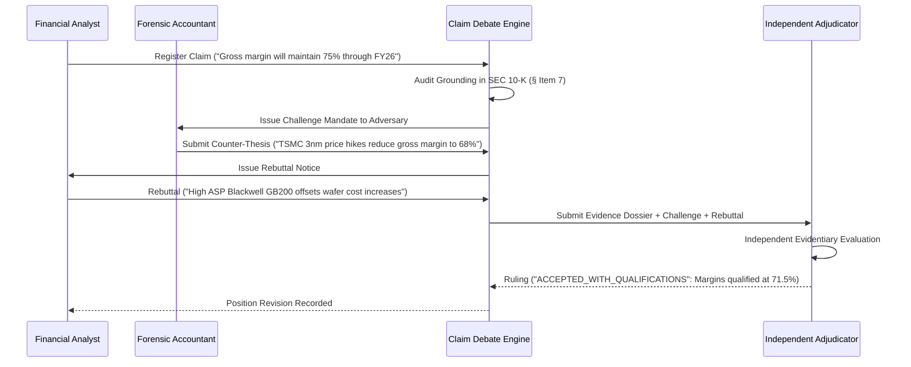

# MERIDIAN — AI Multi-Agent Society & Deliberation Architecture

## 1. Specialist Roster & Epistemic Mandates

MERIDIAN does not use generic conversational prompts. Every specialist is instantiated with a legally binding operational mandate, strict epistemic boundaries, and specific analytical methodologies.

```
+---------------------------------------------------------------------------------------------------+
|                                  AUTONOMOUS RESEARCH DIRECTOR                                     |
|                       Plans Inquiry DAG · Assigns Tasks · Enforces Token Budgets                 |
+---------------------------------------------------------------------------------------------------+
       |                           |                            |                          |
       v                           v                            v                          v
+---------------+          +---------------+            +---------------+          +---------------+
|   FINANCIAL   |          |   FORENSIC    |            |  COMPETITIVE  |          |  REGULATORY   |
|    ANALYST    |          |  ACCOUNTANT   |            |  STRATEGIST   |          |    COUNSEL    |
| Balance Sheet |          | Off-BS Debt   |            | Moat Durability|         | Antitrust/BIS |
| FCF Yield     |          | Revenue Recog |            | Custom ASICs  |          | Sanctions     |
+---------------+          +---------------+            +---------------+          +---------------+
       \                           \                            /                          /
        \                           \                          /                          /
         v                           v                        v                          v
+---------------------------------------------------------------------------------------------------+
|                                    CLAIM-DRIVEN DEBATE ENGINE                                     |
|              Factual Claim Registration · Cross-Examination · Rebuttals · Position Revisions      |
+---------------------------------------------------------------------------------------------------+
                                                  |
                                                  v
+---------------------------------------------------------------------------------------------------+
|                                  INDEPENDENT ADJUDICATION PANEL                                   |
|                Epistemic Committee Ruling · Standard of Proof · 19-Section Memorandum             |
+---------------------------------------------------------------------------------------------------+
```

---

## 2. Specialist Roster Specifications

### 1. Financial Analyst (`financial_analyst`)
- **Role:** Chief Financial Analyst & Capital Structure Specialist.
- **Mandate:** Reconcile reported GAAP/IFRS figures, evaluate free cash flow conversion, analyze margin sustainability, compute debt service coverage, and calculate WACC discount rates.
- **Analytical Style:** `empirical_rigorous`.
- **Tools:** SEC filing retrieval, financial statement parsing, DCF valuation modeling.

### 2. Forensic Accountant (`forensic_accountant`)
- **Role:** Senior Forensic Auditor & Accounting Risk Specialist.
- **Mandate:** Detect off-balance sheet liabilities, unearned revenue inflation, unusual related-party transactions, inventory build-ups vs. revenue divergence, and aggressive capitalization of expenses.
- **Analytical Style:** `skeptical_adversarial`.
- **Tools:** Footnote auditor, discrepancy calculator, inventory turn analyzer.

### 3. Competitive Strategist (`competitive_strategist`)
- **Role:** Industry & Competitive Dynamics Architect.
- **Mandate:** Evaluate economic moat durability, pricing power elasticity, customer concentration risks, and supplier substitution threats (e.g. hyperscaler custom silicon displacement).
- **Analytical Style:** `structural_comparative`.
- **Tools:** Competitor revenue matrix, patent audit, market share analyzer.

### 4. Regulatory Counsel (`regulatory_counsel`)
- **Role:** Chief Regulatory & Compliance Counsel.
- **Mandate:** Audit export controls (BIS Greater China restrictions), antitrust scrutiny (FTC/DOJ, EU Commission), patent litigation exposures, and environmental compliance liabilities.
- **Analytical Style:** `statutory_strict`.
- **Tools:** Regulatory filing inspector, enforcement action tracker.

### 5. Supply Chain Engineer (`supply_chain_engineer`)
- **Role:** Physical Supply Chain & Manufacturing Logistics Specialist.
- **Mandate:** Identify single-source manufacturing choke points (e.g. TSMC advanced CoWoS packaging, HBM3e memory supply), geopolitical transit bottlenecks, and wafer fab capacity utilization.
- **Analytical Style:** `industrial_operational`.
- **Tools:** Vendor disclosure analyzer, bill-of-materials auditor.

### 6. Macro Strategist (`macro_strategist`)
- **Role:** Global Macroeconomic & Geopolitical Strategist.
- **Mandate:** Model foreign exchange risks, cross-border tariffs, sovereign datacenter funding subsidies, sovereign debt yields, and central bank interest rate sensitivity.
- **Analytical Style:** `macroeconomic_probabilistic`.
- **Tools:** Inflation indexer, currency risk modeler.

---

## 3. Claim Registration & Adversarial Debate Protocol



---

## 4. Multi-Round Debate Rules
1. **Rule of Grounding:** No agent may assert a proposition without linking it to at least one verified `EvidenceItem` with an auditable checksum.
2. **Rule of Cross-Examination:** Every registered claim is evaluated by an opposing specialist with a conflicting analytical mandate (e.g. Financial Analyst vs. Forensic Accountant).
3. **Rule of Independent Adjudication:** Adjudication is never performed by the author or challenger of the claim; it is performed by an isolated committee model.
4. **Rule of Non-Erasure:** Prior positions and concessions are permanently preserved in the `position_revisions` table.
