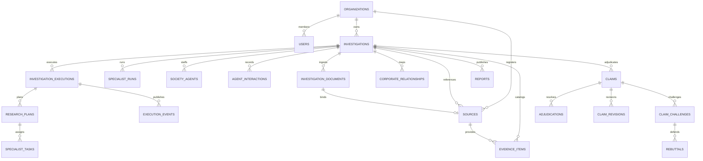

# MERIDIAN — Database Architecture & Data Models

## 1. Relational Database Topology
MERIDIAN uses **SQLAlchemy 2.0** ORM backed by an operational **SQLite 3** relational database configured with Write-Ahead Logging (`PRAGMA journal_mode=WAL`) and foreign key enforcement (`PRAGMA foreign_keys=ON`).

---

## 2. Entity Relationship Diagram (ERD)

---

## 3. Database Table Reference

### Core Multitenancy & Workspace
- `organizations`: Root multitenant boundary (`id`, `name`, `slug`, `tier`, `created_at`).
- `users`: Authenticated users (`id`, `organization_id`, `email`, `hashed_password`, `full_name`, `role`).
- `companies`: Subject entities under investigation (`id`, `name`, `ticker`, `cik`, `domain`, `sector`, `company_type`).
- `investigations`: Primary investigation container (`id`, `organization_id`, `company_id`, `title`, `status`, `depth`, `debate_mode`, `progress_percentage`).

### Multi-Agent Society
- `society_agents`: Active specialist agents (`id`, `investigation_id`, `agent_id`, `name`, `role`, `specialization`, `mandate`, `analytical_style`, `initial_position`, `current_position`, `confidence`, `assumptions`).
- `agent_memories`: Episodic and mandate memories (`id`, `agent_id`, `memory_type`, `content`, `confidence`).
- `agent_interactions`: Live debate transcripts (`id`, `investigation_id`, `sender_agent_id`, `recipient_agent_id`, `interaction_type`, `content`, `round_number`).

### Claims, Evidence & Provenance
- `sources`: Primary documents, SEC filings, regulatory disclosures (`id`, `organization_id`, `title`, `publisher`, `source_category`, `reliability_score`, `checksum`).
- `evidence_items`: Extracted passages (`id`, `investigation_id`, `source_id`, `location_reference`, `extracted_passage`, `is_verified`, `checksum`).
- `claims`: Formal epistemic propositions (`id`, `investigation_id`, `author_agent_id`, `statement`, `category`, `confidence`, `verdict`, `dissenting_agent_ids`).
- `claim_challenges`: Adversarial challenges (`id`, `claim_id`, `challenger_agent_id`, `counter_thesis`, `evidence_citations`).
- `adjudications`: Independent committee rulings (`id`, `claim_id`, `adjudicator_agent_id`, `ruling`, `final_statement`, `confidence`).

### Documents & Deliverables
- `investigation_documents`: Ingested files (`id`, `investigation_id`, `filename`, `file_type`, `file_size_bytes`, `page_or_sheet_count`, `checksum_sha256`, `extraction_status`, `extracted_text`, `extracted_metadata`).
- `reports`: Published 19-section research memoranda (`id`, `investigation_id`, `title`, `executive_summary`, `sections`, `pdf_url`).
- `investigation_executions`: Durable state machine runs (`id`, `investigation_id`, `current_stage`, `status`, `total_tokens`, `estimated_cost_usd`).
- `execution_events`: SSE real-time log records (`id`, `execution_id`, `event_type`, `stage`, `payload`, `created_at`).
