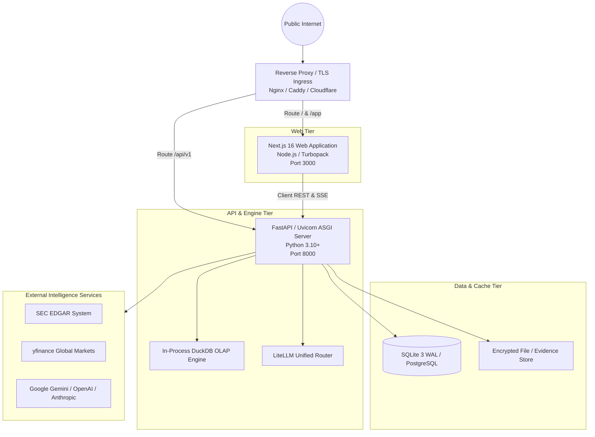

# MERIDIAN — Deployment & Infrastructure Architecture

## 1. Deployment Topology



---

## 2. Environment Configuration Matrix

| Variable Name | Required | Default / Example | Purpose |
| :--- | :--- | :--- | :--- |
| `SECRET_KEY` | Recommended | `meridian-production-secret-institutional-grade-2025` | Signs JWT authentication tokens |
| `DATABASE_URL` | Optional | `sqlite:///./meridian.db` | Relational database connection string |
| `NEXT_PUBLIC_API_URL` | Optional | `http://127.0.0.1:8000/api/v1` | Frontend API base route |
| `GEMINI_API_KEY` | Optional | `AQ.Ab8RN...` | Enables live Google Gemini LLM routing |
| `OPENAI_API_KEY` | Optional | `sk-proj-...` | Enables live OpenAI GPT-4o routing |
| `ANTHROPIC_API_KEY` | Optional | `sk-ant-...` | Enables live Anthropic Claude routing |
| `OLLAMA_BASE_URL` | Optional | `http://127.0.0.1:11434` | Enables local Ollama inference |

---

## 3. Production Service Startup Commands

### Web Application (Next.js)
```bash
cd apps/web
pnpm install
pnpm build
pnpm start -p 3000
```

### API Backend (FastAPI / Uvicorn)
```bash
cd apps/api
pip install -r requirements.txt
uvicorn main:app --host 0.0.0.0 --port 8000 --workers 4
```
