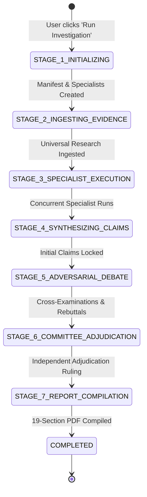

# MERIDIAN — Investigation Execution Lifecycle

## 1. The 7-Stage Durable Execution Pipeline

When a user initiates an investigation in the Workspace (`POST /api/v1/investigations/{id}/executions/start`), the `DurableInvestigationOrchestrator` takes ownership of the execution lifecycle.

---

## 2. Detailed Stage-by-Stage Implementation

### Stage 1: Initializing Manifest & Decomposing Inquiry (`STAGE_1_INITIALIZING`)
- **Code Location:** `DurableInvestigationOrchestrator.run_lifecycle_stage(..., 1)`
- **Actions:**
  - Persists `InvestigationExecution` and `ExecutionManifest` in the database.
  - Queries `Company` metadata and resolves ticker, sector, and CIK.
  - Instantiates the 6 Society Specialists (`financial_analyst`, `forensic_accountant`, `competitive_strategist`, `regulatory_counsel`, `supply_chain_engineer`, `macro_strategist`).
  - Emits SSE Event: `execution.stage_transition` (progress: 10%).

### Stage 2: Evidence Ingestion & Primary Research (`STAGE_2_INGESTING_EVIDENCE`)
- **Code Location:** `research_provider.py` & `DurableInvestigationOrchestrator`
- **Actions:**
  - Calls `UniversalResearchEngine.resolve_company(ticker, company_name)`.
  - Ingests primary SEC 10-K disclosures, `yfinance` live balance sheet metrics, and uploaded `InvestigationDocument` passages.
  - Creates `Source` and `EvidenceItem` records with SHA-256 checksums.
  - Emits SSE Event: `evidence.ingested` (progress: 25%).

### Stage 3: Concurrent Specialist Execution (`STAGE_3_SPECIALIST_EXECUTION`)
- **Code Location:** `specialist_runner.py` & `agent_orchestrator.py`
- **Actions:**
  - Dispatches tasks across active specialists concurrently.
  - Invokes `ModelOrchestrationService.execute_specialist_prompt()`.
  - Gathers findings, updates `tokens_consumed` and `cost_usd`.
  - Records initial positions in `SocietyAgent.current_position`.
  - Emits SSE Event: `specialists.completed` (progress: 45%).

### Stage 4: Factual Claim Registration (`STAGE_4_SYNTHESIZING_CLAIMS`)
- **Code Location:** `claim_debate_engine.py`
- **Actions:**
  - Parses specialist outputs into discrete falsifiable propositions (`Claim` records).
  - Categorizes claims (`financial`, `risk`, `market`, `governance`, `competitive`).
  - Computes initial confidence scores and binds claims to supporting `EvidenceItem` IDs.
  - Emits SSE Event: `claims.registered` (progress: 60%).

### Stage 5: Adversarial Debate Rounds (`STAGE_5_ADVERSARIAL_DEBATE`)
- **Code Location:** `claim_debate_engine.py` & `scenario_simulation_engine.py`
- **Actions:**
  - Pairs each claim with an opposing specialist (e.g. Financial Analyst claims challenged by Forensic Accountant).
  - Generates `ClaimChallenge` records with counter-theses.
  - Author specialist submits `Rebuttal` defending or conceding the claim.
  - Generates `AgentInteraction` transcript records.
  - Emits SSE Event: `debate.round_completed` (progress: 75%).

### Stage 6: Independent Committee Adjudication (`STAGE_6_COMMITTEE_ADJUDICATION`)
- **Code Location:** `claim_debate_engine.py`
- **Actions:**
  - An independent committee adjudicator evaluates the claim, supporting evidence, challenge, and rebuttal.
  - Issues formal ruling (`ACCEPTED`, `REJECTED`, `ACCEPTED_WITH_QUALIFICATIONS`).
  - Records `Adjudication` and updates `Claim.verdict`.
  - Emits SSE Event: `adjudication.completed` (progress: 90%).

### Stage 7: Memorandum Compilation & PDF Generation (`STAGE_7_REPORT_COMPILATION`)
- **Code Location:** `investment_dossier.py`
- **Actions:**
  - Assembles the formal 19-section Institutional Investment Memorandum.
  - Calculates Monte Carlo scenario distributions via DuckDB.
  - Compiles the official downloadable ReportLab PDF.
  - Updates `Investigation.status = "completed"` (progress: 100%).
  - Emits SSE Event: `stream.ended` and `execution.completed`.
