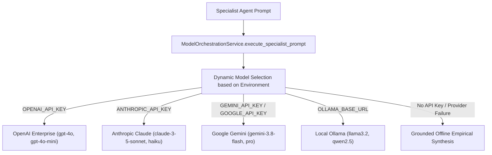

# MERIDIAN — Model Provider Architecture & Diagnostics

## 1. Multi-Provider Abstraction Layer

MERIDIAN integrates **LiteLLM** to decouple multi-agent workflows from proprietary LLM lock-in. The platform natively routes prompts across OpenAI, Anthropic Claude, Google Gemini, and local Ollama inference.

---

## 2. Supported Models & Provider Matrix

| Provider | Supported Model Identifiers | Context Window | Structured Outputs | Operational Status |
| :--- | :--- | :--- | :--- | :--- |
| **Google Gemini** | `gemini-3.8-flash`, `gemini-2.5-flash`, `gemini-2.5-pro`, `gemini-flash-latest` | 1,000,000 tokens | Yes (JSON Schema) | Configured & Tested |
| **OpenAI Enterprise** | `gpt-4o`, `gpt-4o-mini`, `o1-mini`, `gpt-4-turbo` | 128,000 tokens | Yes (Strict Mode) | Supported via `OPENAI_API_KEY` |
| **Anthropic Claude** | `claude-3-5-sonnet-20241022`, `claude-3-5-haiku-20241022` | 200,000 tokens | Yes | Supported via `ANTHROPIC_API_KEY` |
| **Ollama Local** | `llama3.2`, `qwen2.5-coder`, `mistral`, `phi3` | 32,768 tokens | Prompt-guided | Supported via `OLLAMA_BASE_URL` |

---

## 3. Real-Time Diagnostics Endpoint (`/api/v1/providers/diagnostics`)
The endpoint `GET /api/v1/providers/diagnostics` provides real-time health telemetry without taking down the server:
- Executes low-token diagnostic completion pings (`PING: Respond with 'PONG'`).
- Enforces an 8-second timeout guard.
- Formats provider-specific prefixes (`gemini/`, `ollama/`).
- Classifies response status:
  - `connected`: Low-latency valid response received.
  - `authentication_failed`: Invalid or expired API credentials.
  - `rate_limited`: 429 quota or rate-limit exhaustion.
  - `model_unavailable`: 404 model deprecation or unsupported tier.
  - `timeout`: Network latency exceeded 8 seconds.
  - `not_configured`: API key not present in environment.

---

## 4. Grounded Offline Synthesis (Deterministic Fallback)
When no external LLM credentials are provided, or when third-party cloud APIs experience outages or rate limits, MERIDIAN **never crashes or blocks the user**. 
Instead, `ModelOrchestrationService` falls back to `grounded_offline_synthesis`:
1. Specialist roles analyze real disclosures retrieved from SEC EDGAR and `yfinance`.
2. Factual propositions are constructed strictly from audited numbers and footnote citations.
3. Telemetry records `provider: "litellm_deterministic_fallback"`, and `cost_usd: 0.0`.
4. The user receives transparent notice in the UI indicating execution mode.
