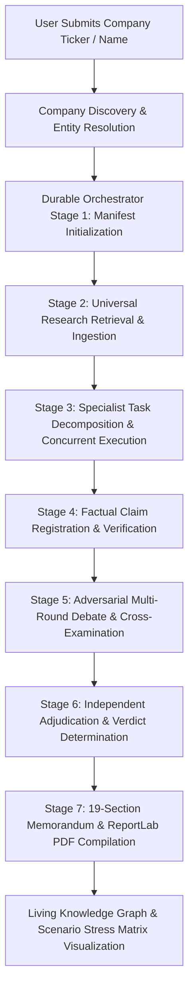

# MERIDIAN — Project Overview & First-Principles Architecture

## 1. What is MERIDIAN?
MERIDIAN is an institutional-grade, autonomous multi-agent corporate intelligence and research platform. It is engineered to transform raw, noisy corporate disclosures, SEC filings, financial databases, and external web intelligence into evidence-backed, adversarially tested, and independently adjudicated company intelligence dossiers.

Its core operating philosophy:
> **"Understand the company behind the numbers."**

Rather than functioning as a chatbot or a simple prompt wrapper, MERIDIAN operates as an autonomous research organization composed of specialized independent agents (Financial Analysts, Forensic Accountants, Competitive Strategists, Regulatory Counsel, Supply Chain Engineers, and Macroeconomists) coordinated under a structured epistemic lifecycle.

---

## 2. The Problem It Solves

### The Information Disconnect in Institutional Research
1. **Shallow Synthesis & Hallucination Risk:** Standard LLMs hallucinate financial numbers, revenue figures, debt structures, and contractual relationships when queried about complex enterprises.
2. **Confirmation Bias in Single-Prompt Systems:** Standard AI workflows output monolithic answers that never challenge their own assertions. Institutional investors require debate, counter-evidence, cross-examination, and scenario stress testing before allocating capital.
3. **Disparate Data Silos:** Financial statements (SEC 10-K/10-Q), market multiples, supply chain disclosures, regulatory enforcement actions, and management commentary live in separate systems without unified ontological linkage.
4. **Lack of Provenance:** Financial research without auditable citations, cryptographic checksums, and location references (§ Item 7, Page N) cannot pass institutional compliance.

---

## 3. Explaining MERIDIAN Across Three Levels

### Level 1: Simple Explanation (For Non-Technical Users)
Imagine an institutional investment committee staffed by six relentless specialists:
- One investigates the balance sheet and cash flow.
- Another searches for hidden accounting risks.
- A third examines supply chain bottlenecks.
- Others analyze competitive threats and regulatory filings.

Instead of agreeing immediately, these specialists challenge each other's claims in a formal adversarial debate. If an analyst claims margins will stay at 75%, a forensics specialist presents supplier price hike evidence to counter it. An independent adjudicator evaluates the evidence and delivers an audited, 19-section investment memorandum with verifiable citations.

### Level 2: Product & Business Explanation
MERIDIAN targets equity research divisions, hedge funds, private equity firms, corporate development teams, and venture capital investment committees. It reduces a 40-hour company due-diligence workflow to a durable, multi-agent automated execution that produces:
- A formal 19-section Institutional Investment Memorandum (exportable as an audit-grade ReportLab PDF).
- A living Corporate Knowledge Graph mapping customers, suppliers, competitors, and regulatory bodies.
- A 4-Scenario Financial & Valuation Stress Matrix evaluated under Monte Carlo and DuckDB analytical engines.
- An auditable Claim & Evidence Registry with cryptographic SHA-256 provenance.

### Level 3: Deep Technical Explanation
MERIDIAN is a full-stack, distributed multi-agent system built on Next.js 16 (React 19, Tailwind CSS v4, Lucide) and FastAPI (Python 3.10+, SQLAlchemy 2.0, DuckDB, LiteLLM):
- **Universal Company Resolution:** Grounded multi-tier resolver integrating SEC EDGAR (CIK lookup), live `yfinance` global equity pricing/fundamentals, and private venture disclosure ingestion with zero financial hallucination.
- **Durable Orchestration Engine:** 7-stage state machine (`durable_investigation_orchestrator.py`) managing task decomposition, concurrent specialist execution, claim extraction, adversarial debate rounds, position revisions, and independent adjudication.
- **Multi-Format Ingestion:** PyMuPDF, `python-docx`, `openpyxl`, `pandas`, `python-pptx`, and `BeautifulSoup4` with multi-encoding fallback (`utf-8`, `latin-1`, `cp1252`) and SHA-256 checksumming.
- **Multi-Model Portability:** LiteLLM unified router supporting OpenAI, Anthropic Claude, Google Gemini (`gemini-3.8-flash`), and local Ollama inference with automatic fallback to grounded empirical synthesis.
- **Deterministic Analytics:** DuckDB in-process OLAP engine executing Monte Carlo scenario simulations and multi-currency valuation conversion (USD to INR Lakh/Crore standards).

---

## 4. Complete Product Lifecycle

