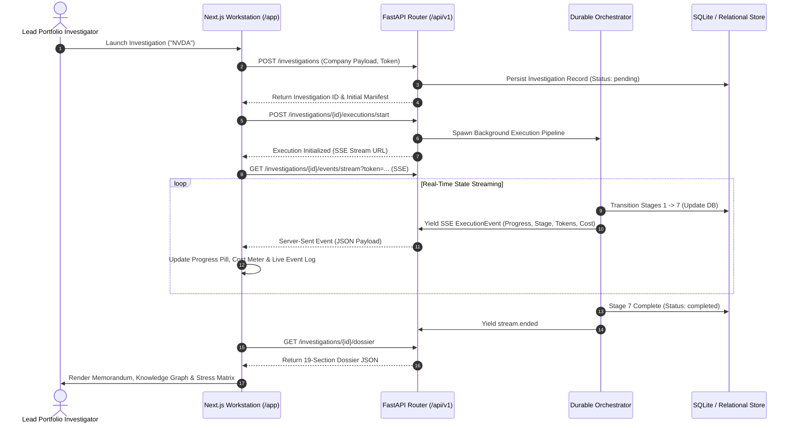
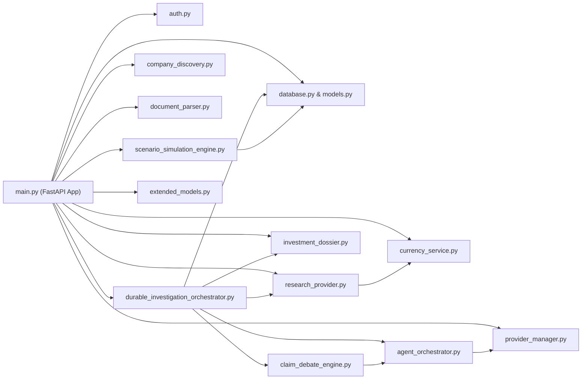
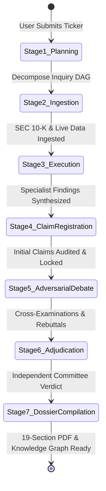

# MERIDIAN — System Architecture & Technical Topology

## 1. High-Level System Architecture

```mermaid
graph TB
    subgraph Client ["Client Layer (Next.js 16 + React 19)"]
        Landing["Landing Page (/)<br/>Interactive Scenarios & Masthead"]
        App["Institutional Workspace (/app)<br/>6 Primary Tabs + Living Graph"]
        Demo["Executive Demo (/demo)<br/>19-Section Dossier & Audit Ledger"]
        State["Client State & SSE Engine<br/>localStorage Rehydration & Reconnect"]
    end

    subgraph API ["API & Routing Layer (FastAPI)"]
        Router["HTTP & SSE Endpoints (/api/v1)"]
        Auth["JWT & Argon2 / bcrypt Authentication"]
        CORS["CORS & Origin Policies"]
        Telemetry["Telemetry & Token Cost Tracker"]
    end

    subgraph Orchestration ["Core Multi-Agent Orchestration Layer"]
        DurableOrch["Durable Investigation Orchestrator<br/>7-Stage Resilient State Machine"]
        ResearchDirector["Autonomous Research Director<br/>DAG Decomposition & Specialist Routing"]
        DebateEngine["Claim-Driven Debate Engine<br/>Challenge, Rebuttal & Revision Matrix"]
        ScenarioEngine["Scenario Simulation Engine<br/>DuckDB OLAP & Monte Carlo Modeling"]
        DossierGen["Investment Dossier Generator<br/>ReportLab PDF Engine"]
    end

    subgraph Ingestion ["Universal Ingestion & Research Layer"]
        UniversalResearch["Universal Company Research Engine<br/>SEC EDGAR, yfinance, Wikipedia, Startups"]
        DocParser["Document Parsing Service<br/>PyMuPDF, docx, openpyxl, pandas, pptx"]
        Discovery["Company Discovery Engine<br/>Ticker, CIK & Domain Matching"]
        Currency["Currency Service<br/>RBI Reference Rate & Indian Numbering"]
    end

    subgraph LLM ["Model Abstraction & Provider Layer"]
        LiteLLMRouter["LiteLLM Unified Router<br/>Dynamic Model Selection & Timeout Guard"]
        ProviderDiag["Provider Manager Diagnostics<br/>Latency Benchmarks & Health Matrix"]
        OfflineSynth["Grounded Offline Synthesis<br/>Deterministic Fallback Engine"]
    end

    subgraph Storage ["Persistence & Data Layer"]
        SQLiteDB[(Relational DB / SQLite 3<br/>WAL Mode, Foreign Key Constraints)]
        FileStore["Document & Artifact Store<br/>Evidence SHA-256 Hashes"]
    end

    Client -->|REST & SSE Events| API
    API --> Orchestration
    Orchestration --> Ingestion
    Orchestration --> LLM
    Orchestration --> Storage
    Ingestion --> Storage
```

---

## 2. Frontend / Backend Communication Architecture

---

## 3. Backend Service Dependency Graph

---

## 4. Multi-Agent Society & Deliberation Lifecycle

